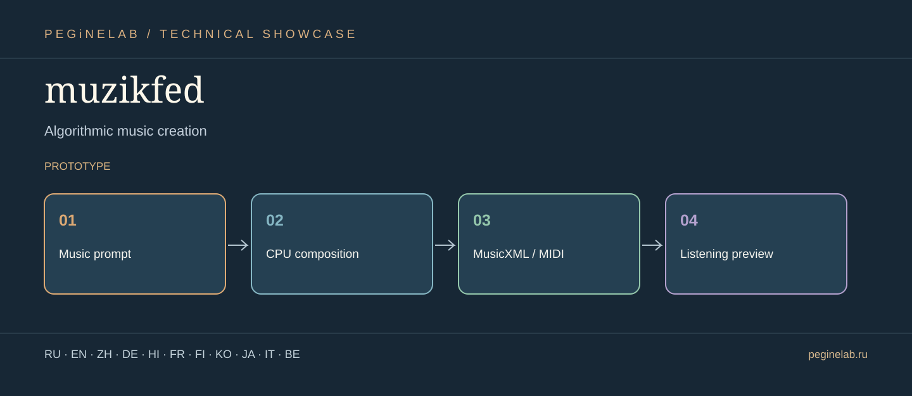

# muzikfed · Vector showcase & translations

**Алгоритмическая музыка / Algorithmic music creation** · **Status:** prototype.

**Prototype warning:** CPU-generated MIDI/MusicXML is not the same as ready-made professional vocal audio.

**Document languages:** Eleven translations of the project overview. This is **not** a claim that every button, voice, or technical instruction is translated.

### Русский · ru
Pocket Orchestra: алгоритмическая оркестровка, MIDI и MusicXML.. **muzikfed**: Music prompt → CPU composition → MusicXML / MIDI → Listening preview.

### English · en
Pocket Orchestra: algorithmic orchestration, MIDI and MusicXML.. **muzikfed**: Music prompt → CPU composition → MusicXML / MIDI → Listening preview.

### 简体中文 · zh
Pocket Orchestra：算法编曲、MIDI 与 MusicXML。. **muzikfed**: Music prompt → CPU composition → MusicXML / MIDI → Listening preview.

### Deutsch · de
Pocket Orchestra: algorithmische Orchestrierung, MIDI und MusicXML.. **muzikfed**: Music prompt → CPU composition → MusicXML / MIDI → Listening preview.

### हिन्दी · hi
Pocket Orchestra: एल्गोरिदमिक ऑर्केस्ट्रेशन, MIDI और MusicXML।. **muzikfed**: Music prompt → CPU composition → MusicXML / MIDI → Listening preview.

### Français · fr
Pocket Orchestra : orchestration algorithmique, MIDI et MusicXML.. **muzikfed**: Music prompt → CPU composition → MusicXML / MIDI → Listening preview.

### Suomi · fi
Pocket Orchestra: algoritminen orkestrointi, MIDI ja MusicXML.. **muzikfed**: Music prompt → CPU composition → MusicXML / MIDI → Listening preview.

### 한국어 · ko
Pocket Orchestra: 알고리즘 편곡, MIDI 및 MusicXML.. **muzikfed**: Music prompt → CPU composition → MusicXML / MIDI → Listening preview.

### 日本語 · ja
アルゴリズム作曲. **muzikfed**: Music prompt → CPU composition → MusicXML / MIDI → Listening preview.

### Italiano · it
Creazione musicale algoritmica. **muzikfed**: Music prompt → CPU composition → MusicXML / MIDI → Listening preview.

### Беларуская · be
Алгарытмічнае стварэнне музыкі. **muzikfed**: Music prompt → CPU composition → MusicXML / MIDI → Listening preview.

## Контакты · Contacts

- [Telegram @Feudorlab1](https://t.me/Feudorlab1)
- [Phone +7 926 041 1145](tel:+79260411145)
- [feudor.lab@yandex.ru](mailto:feudor.lab@yandex.ru) · [obzorniky@gmail.com](mailto:obzorniky@gmail.com)
- [peginelab.ru](https://peginelab.ru/) · [GitHub project](https://github.com/musikfed/muzikfed)

The root README contains authoritative development and test status.
